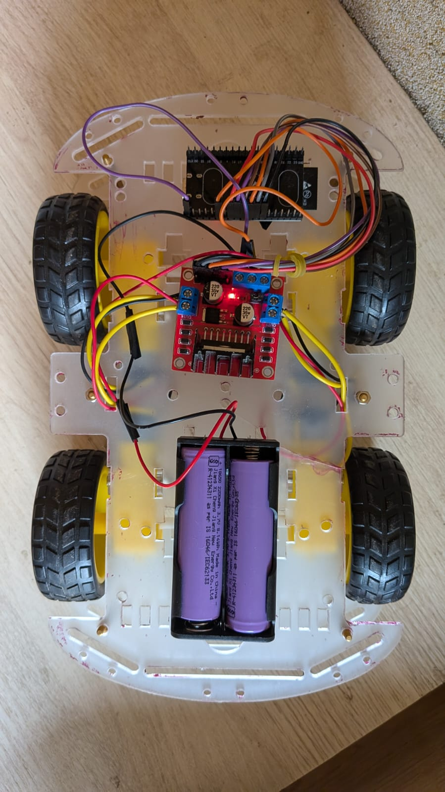
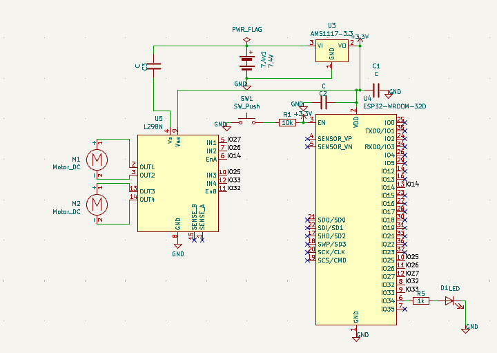

# BLE-Controlled 4-Wheel Rover
### ESP32 | Bluetooth Low Energy | L298N | PWM Motor Control | PlatformIO

A four-wheel mobile robotic platform developed using the ESP32 microcontroller, featuring wireless control over Bluetooth Low Energy (BLE), independent motor-direction control, and PWM-based speed regulation.

The project focuses on practical embedded systems development, integrating wireless communication, GPIO interfacing, motor-driver control, power management, and firmware-level motion control into a functional robotic platform.

---

## 1. Project Overview

The BLE-Controlled 4-Wheel Rover is an embedded robotic vehicle that receives wireless commands from a smartphone and translates them into motor-control signals through an ESP32 and L298N dual H-bridge motor driver.

The rover uses four DC motors arranged as two motor groups:

- Left motor group: Two motors connected in parallel.
- Right motor group: Two motors connected in parallel.

The ESP32 processes incoming BLE commands and controls the direction and speed of the two motor groups.

A 2S Li-ion battery provides the primary power source, while a regulated 5V supply supports the system's low-voltage power requirements.

**Primary engineering objectives:**
- Implement wireless BLE-based vehicle control.
- Interface an ESP32 with a dual H-bridge motor driver.
- Implement direction control using GPIO signals.
- Regulate motor speed using PWM.
- Develop a practical power-distribution arrangement.
- Troubleshoot motor polarity, low-speed torque and power-delivery issues.

## 2. System Architecture

The system follows a command-to-actuation architecture.

```text
       Smartphone
            |
            | Bluetooth Low Energy
            v
       ESP32 DevKit
            |
      +-----+------+
      |            |
   Direction     PWM Speed
    Control       Control
      |            |
      +-----+------+
            |
            v
       L298N Driver
            |
       +----+----+
       |         |
   Left Motors  Right Motors
    (2 DC)       (2 DC)
       |         |
       +----+----+
            |
       Vehicle Motion
```

### Functional sequence

1. The smartphone establishes BLE communication with the ESP32.
2. A movement command is transmitted from the smartphone.
3. The ESP32 processes the received command.
4. GPIO signals determine the motor direction.
5. PWM signals regulate the motor-driver enable inputs.
6. The L298N drives the corresponding motor groups.
7. The rover moves according to the received command.

## 3. Hardware Architecture

| Component | Function |
|---|---|
| ESP32 DevKit V1 (ESP32-32D) | Main controller and BLE communication |
| L298N | Dual H-bridge DC motor driver |
| 4 × DC geared motors | Vehicle propulsion |
| 2S Li-ion battery (7.4V nominal) | Primary power source |
| 5V regulator | Regulated low-voltage supply |
| Smartphone | Wireless command interface |
| Chassis and wheels | Mechanical platform |

### Motor configuration

The four motors are arranged into two independently controlled groups.

- Left-side motors are connected in parallel.
- Right-side motors are connected in parallel.
- Each motor group is controlled through one L298N H-bridge channel.

This arrangement allows differential steering.

For example:
- Both sides rotating forward produces forward motion.
- Both sides rotating backward produces reverse motion.
- Opposite motor directions produce turning or rotation.
- Different left/right motor speeds produce curved movement.

## 4. ESP32 GPIO Configuration

The following GPIO mapping is implemented in the firmware.

| ESP32 GPIO | L298N connection | Function |
|---|---|---|
| GPIO 27 | IN1 | Motor direction control |
| GPIO 26 | IN2 | Motor direction control |
| GPIO 25 | IN3 | Motor direction control |
| GPIO 33 | IN4 | Motor direction control |
| GPIO 14 | ENA | PWM speed control |
| GPIO 32 | ENB | PWM speed control |

The four direction-control pins determine the polarity applied across the motor groups.

The two enable pins receive PWM signals for speed regulation.

## 5. Motor Control and PWM Implementation

### 5.1 Direction control

The ESP32 uses digital GPIO outputs to control the L298N H-bridge inputs.

An H-bridge changes the polarity applied to a DC motor, allowing it to rotate in either direction.

The motor direction is determined by the combination of the corresponding input signals.

### 5.2 PWM-based speed control

Pulse Width Modulation (PWM) is used to regulate the average voltage applied to the motor through the driver.

Instead of continuously changing the supply voltage, the controller switches the signal ON and OFF at a fixed frequency.

The duty cycle determines the proportion of time the signal remains ON.

A higher duty cycle generally produces greater motor speed, subject to motor loading, supply voltage and driver losses.

**Implemented PWM configuration:**

| Parameter | Configuration |
|---|---|
| PWM frequency | 5,000 Hz |
| PWM resolution | 8-bit |
| PWM channels | 0 and 1 |
| Maximum configured speed | 220 |
| Acceleration increment | 8 |

With 8-bit resolution, the theoretical PWM range is 0–255.

The configured maximum speed of 220 corresponds to approximately 86.3% duty cycle.

\[
D = \frac{220}{255}\times100 \approx 86.3\%
\]

### 5.3 Acceleration control

The firmware uses an acceleration increment of 8 to adjust the commanded speed progressively.

Rather than immediately jumping to the target PWM value, speed changes are applied in smaller increments.

This helps reduce abrupt changes in motor drive commands and supports smoother motion.

Note: This is command-level PWM ramping, not closed-loop acceleration control using wheel encoders or an inertial sensor.

## 6. Bluetooth Low Energy Communication

The ESP32 provides the wireless communication interface through BLE.

The rover uses a BLE Nordic UART Service (NUS)-style communication interface and is controlled using the Serial Bluetooth Terminal application.

The communication path is:

```text
Smartphone Application
          |
          | BLE
          v
    ESP32 BLE Service
          |
     Command Processing
          |
     Motor Control Logic
          |
      L298N Driver
```

The BLE interface allows movement commands to be sent wirelessly without a physical control cable.

The project demonstrates the integration of wireless communication with real-time embedded hardware control.

## 7. Power Distribution

The rover uses a 2S Li-ion battery with a nominal voltage of 7.4V.

A regulated 5V supply is incorporated into the power arrangement.

The system uses a common ground reference between the controller and motor-driver control circuitry.

**Power architecture:**

```text
       2S Li-ion Battery
          7.4V nominal
                |
          Power Distribution
             /       \
            /         \
     Motor Supply    5V Regulator
          |               |
          v               v
        L298N            ESP32
          | 
       DC Motors

     Common Ground Reference
```

### Power-design considerations

- Motor current demand can vary significantly with mechanical load.
- Startup and stall conditions can produce high current demand.
- Voltage drops in the supply path can affect motor performance.
- The motor supply and logic supply must be appropriately regulated.
- The ESP32 and motor-driver control circuitry require a common ground reference.
- The L298N introduces voltage losses due to its bipolar transistor output stage.

The power arrangement was refined during development to address motor performance and supply-distribution issues.

## 8. Engineering Challenges and Debugging

Several practical hardware-integration issues were addressed during development.

| Challenge | Engineering work |
|---|---|
| Incorrect motor polarity | Corrected motor connections and direction mapping |
| Low-speed torque | Refined motor drive and PWM behaviour |
| Power-distribution problems | Improved battery and regulated-supply arrangement |
| Four-motor integration | Configured left and right motor groups |
| Wireless operation | Integrated BLE command communication with motor control |

The final implementation operates all four wheels reliably.

## 9. Development Environment

| Tool / Platform | Purpose |
|---|---|
| Visual Studio Code | Development environment |
| PlatformIO | Embedded project management and build system |
| Arduino framework | ESP32 firmware framework |
| C++ | Firmware development |
| Git and GitHub | Version control and project documentation |

### Project structure

```text
BLE-Controlled-4-Wheel-Rover/
│
├── .gitignore
├── platformio.ini
│
├── include/
│
├── lib/
│
├── src/
│   └── main.cpp
│
└── test/
```

### Build and upload

1. Install Visual Studio Code.
2. Install the PlatformIO IDE extension.
3. Clone or download this repository.
4. Open the project folder in VS Code.
5. Connect the ESP32 development board.
6. Build and upload using PlatformIO.

Alternatively, use the PlatformIO CLI:

```bash
pio run
pio run --target upload
pio device monitor
```

The serial monitor is useful for observing firmware output and debugging communication.

## 10. Current Implementation Status

| Feature | Status |
|---|---|
| ESP32 firmware | Implemented |
| BLE communication | Implemented |
| Smartphone-based control | Implemented |
| GPIO motor direction control | Implemented |
| PWM motor speed control | Implemented |
| Four-wheel motor integration | Working |
| 2S Li-ion power arrangement | Implemented |
| Hardware debugging | Completed for current implementation |

## 11. Future Development

Potential extensions to the platform include:

- Wheel encoders for closed-loop speed control.
- PID-based motor-speed regulation.
- IMU integration for orientation sensing.
- Obstacle detection and avoidance.
- Autonomous navigation.
- GPS-based waypoint navigation.
- Integration with a modular vehicle-controller architecture.

These are proposed extensions, not features of the current implementation.

## 12. Project Significance

This project provided practical experience in:

- ESP32-based embedded firmware development.
- BLE communication and wireless command handling.
- GPIO-based hardware interfacing.
- PWM generation and motor-speed regulation.
- H-bridge motor-driver operation.
- Multi-motor integration.
- Embedded power-distribution considerations.
- Hardware debugging and iterative system development.

It demonstrates the integration of embedded firmware, wireless communication and electromechanical hardware into a working robotic system.

---

**Project:** BLE-Controlled 4-Wheel Rover  
**Controller:** ESP32 DevKit V1  
**Motor Driver:** L298N  
**Communication:** Bluetooth Low Energy  
**Firmware Environment:** PlatformIO / Arduino Framework  
**Language:** C++

**Status: Functional prototype — four-wheel BLE-controlled operation.**
## Project Gallery

### Physical Rover



### Electrical Schematic



---
### Rover Demonstration

[Watch the BLE-Controlled Rover Demo](videos/rover-demo.mp4)